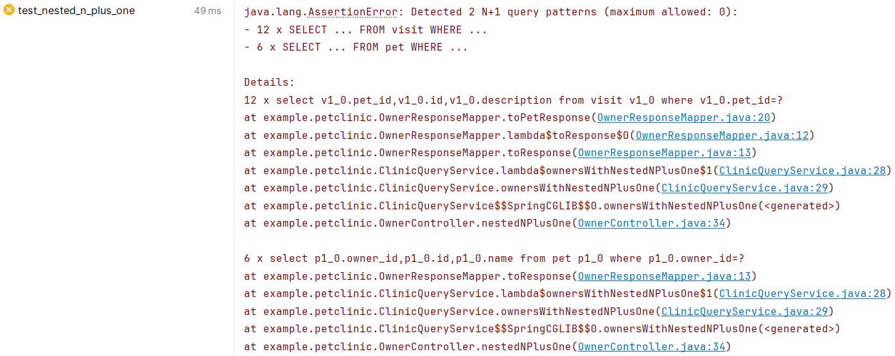
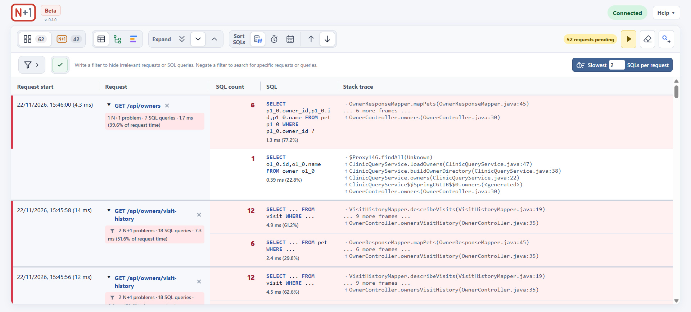
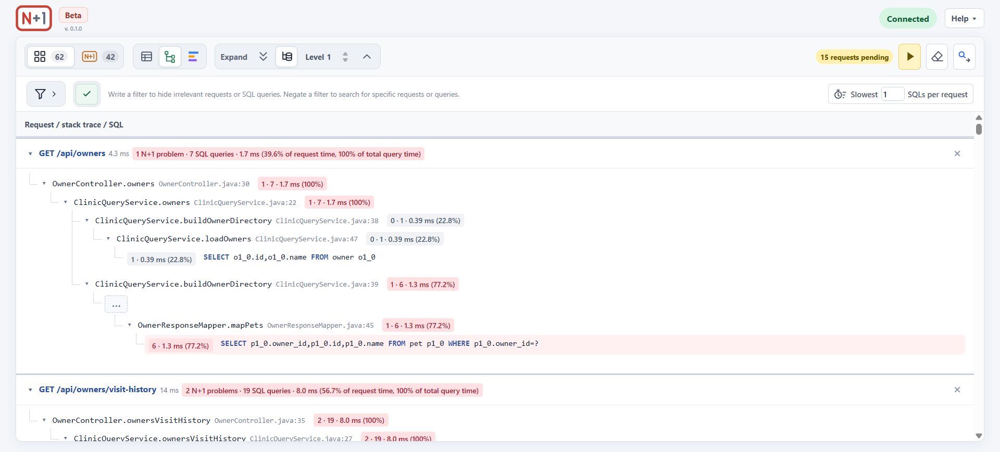
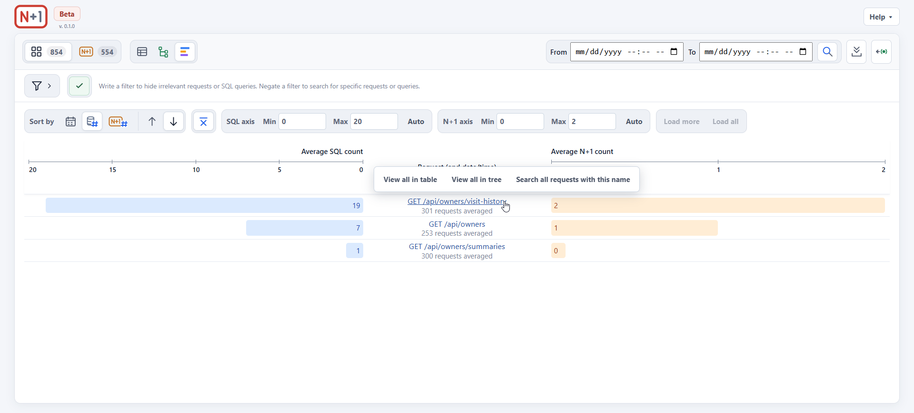
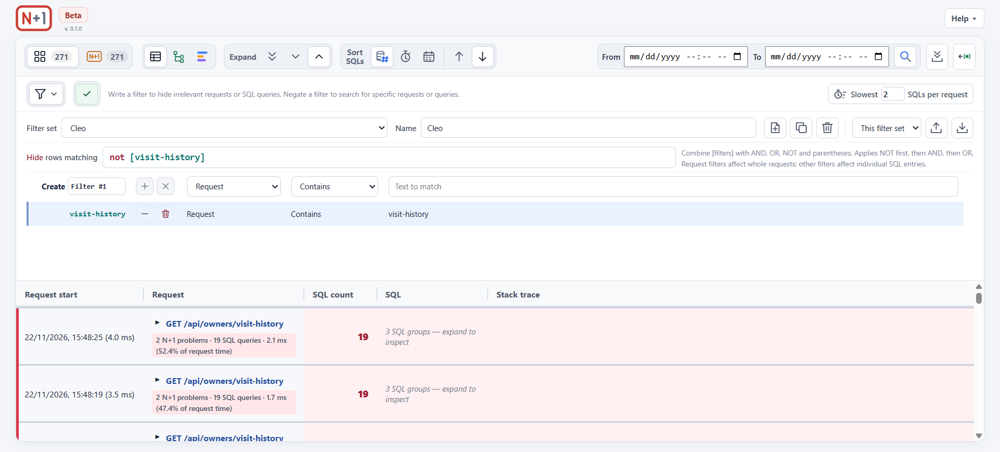
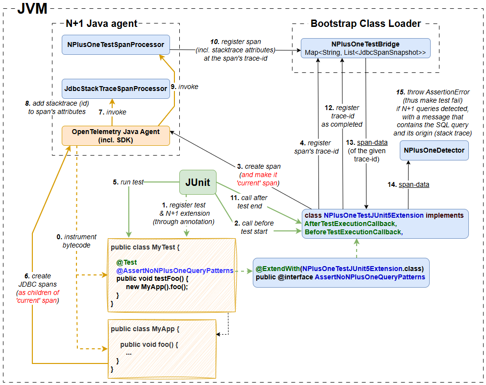
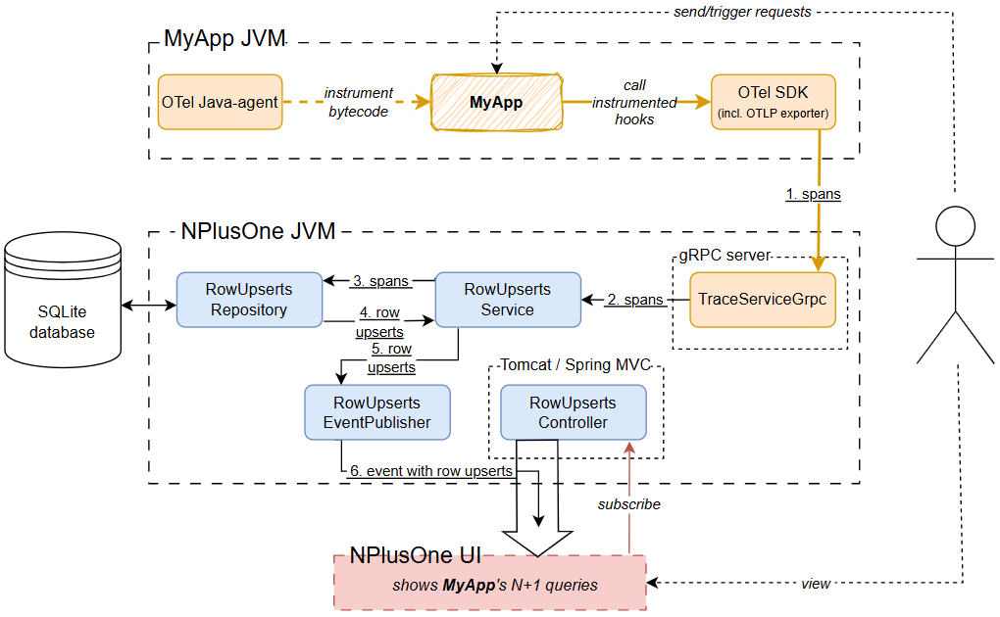

<div align="center">

<h1></h1>

[](https://github.com/bl-g/NPlusOne/actions/workflows/build_and_test.yml)
[](https://www.oracle.com/java/)
[](LICENSE)

[**Test assertions**](#test-assertions-details) ◇ [Usage](#test-usage) ◇ [Architecture](#test-impl) ◆ [FAQ](faq-and-example-projects) ◆ [**Runtime monitor**](#runtime-detection-details) ◇ [Usage](#runtime-usage) ◇ [Architecture](#runtime-impl)

</div>

NPlusOne finds N+1 query problems in Java applications.
It shows the repeated SQL query and the stack trace that triggered it.
Use it to monitor a running application or apply it in JUnit tests.
NPlusOne works with any JDBC-based ORM, including Hibernate, and does not require changes to the application's source code.

#### Test assertions
NPlusOne makes JUnit tests fail if the tested code triggers N+1 query issues. To work smoothly with real-world codebases, it:
- Supports parallel test runs. Queries are captured per test, even if other tests run at the same time.
- Supports application code that runs on a different thread than the test thread.
NPlusOne uses OpenTelemetry under the hood, which supports the required [context propagation](https://opentelemetry.io/docs/concepts/context-propagation/) out of the box for many [libraries and frameworks](https://opentelemetry.io/docs/zero-code/java/agent/supported-libraries/) including Java Executors and Kotlin coroutines.
- Can easily be applied through a Maven or Gradle plugin. Similarly, it can easily be disabled through a system property or build file boolean.
- Lets you filter SQL queries and application stack traces to focus on the code that should be tested, so that test setup queries and other noise do not distort findings.
- Offers additional configuration options, including a configurable number of allowed (legacy) N+1 patterns.
- Shows informative failure messages containing the repeated SQL, execution counts and relevant stack traces.



#### Runtime monitor
While your application runs as usual, NPlusOne gathers SQL queries per HTTP request and alerts you to possible N+1 query patterns and their code origins.
The web UI shows supports several views and features:
- A table view to get an overview of all SQL queries triggered by a HTTP-request, plus their counts and duration.
- A tree view to dig into a stack trace and see which methods trigger which SQL queries and N+1 issues.
- A bar chart for a high-level overview of all HTTP requests and how many SQL queries and N+1 issues they cause.
- A range of filter, search and sort functionalities to quickly find the HTTP request and SQL queries of interest.
- A live monitor mode as well as a search mode.
The search mode can be used to analyze data gathered at previous live sessions.

*Click a screenshot to view it at full size.*

| Table view | Tree view |
| :---: | :---: |
| [](docs/imgs/table_view.png) | [](docs/imgs/tree_view.png) |
| **Bar chart** | **Search and filters** |
| [](docs/imgs/bar_chart.png) | [](docs/imgs/search_and_filter.png) |

<a id="test-assertions-details"></a>
# Test assertions

<a id="test-usage"></a>
## Usage
Get started with the test assertions by adding the NPlusOne plugin and test dependency to your build file or POM.

### Gradle
Add the plugin:
```kotlin
plugins {
    id("com.goosb.nplusone") version "0.1.0-beta.1"
}
```

Additionally, add either `nplusone-test-junit4` or `junit-jupiter` (JUnit 5 and 6) as `testImplementation` dependency. 
Example:
```kotlin
plugins {
    testImplementation("com.goosb.nplusone:nplusone-test-junit-jupiter:0.1.0-beta.1")
}
```

### Maven
Add the plugin:
```xml
<plugin>
    <groupId>com.goosb.nplusone</groupId>
    <artifactId>nplusone-plugin-maven</artifactId>
    <version>0.1.0-beta.1</version>
    <executions>
        <execution>
            <goals>
                <goal>prepare-agent</goal>
            </goals>
        </execution>
    </executions>
</plugin>
```

Additionally, add either `nplusone-test-junit4` or `junit-jupiter` (JUnit 5 and 6) as test dependency. 
Example:
```xml
<dependency>
    <groupId>com.goosb.nplusone</groupId>
    <artifactId>nplusone-test-junit-jupiter</artifactId>
    <version>0.1.0-beta.1</version>
    <scope>test</scope>
</dependency>
```

### Test code
Finally, annotate the relevant test methods with `@AssertNoNPlusOneQueryPatterns`, and enable the NPlusOne test mechanism:
- JUnit 5 & 6: annotate the class with `@ExtendWith(NPlusOneTestJupiterExtension.class)`
- JUnit 4: add the field: `@Rule public final NPlusOneQueriesJUnit4Rule detector = new NPlusOneQueriesJUnit4Rule();`

See the [test assertions FAQ](faq-and-example-projects/README.md#test-assertions-faq) for examples and more guidance on how to get started, as well as answers to common questions:

- [How do I get started with the test assertions?](faq-and-example-projects/README.md#quick-start-test-asserts)
- [How do I configure the test assertions?](faq-and-example-projects/README.md#configure-test-asserts)
- [How do I disable the test assertions?](faq-and-example-projects/README.md#disable-test-asserts)
- [How do I exclude SQL noise, such as queries from the test setup?](faq-and-example-projects/README.md#avoid-sql-noise)
- [How do I reuse an `@AssertNoNPlusOneQueryPatterns` configuration?](faq-and-example-projects/README.md#reuse-annotation-config)
- [What changes does NPlusOne require when migrating from JUnit 4 to JUnit 5?](faq-and-example-projects/README.md#junit-4-to-5)
- [What happens if a test fails for a reason other than N+1 issues?](faq-and-example-projects/README.md#test-failure)
- [Why does my test pass even though I expect an N+1 issue?](faq-and-example-projects/README.md#no-test-assertions)
- [How do I debug the test assertions?](faq-and-example-projects/README.md#debug-test-assertions)

<a id="test-impl"></a>
## High-level implementation overview

NPlusOne uses OpenTelemetry (OTel) to collect the SQL queries triggered by a JUnit test and thereby identify possible N+1 query problems.
The implementation, as illustrated in the image below, consists of roughly three parts:
- A custom Java agent that wraps OTel's Java agent along with two custom span processors.
The test should run with this Java agent so that OTel's Java agent can instrument the application's bytecode to create a span for each JDBC query.
- A JUnit 5 extension, which also works with JUnit 6 (or an equivalent JUnit 4 rule).
This extension creates a root span for each test and marks this span as the current span.
By marking a span as the current span, OTel's SDK automatically makes this span the parent of spans created within its scope.
Spans that belong to the same span hierarchy also have the same trace ID, which is how NPlusOne knows which JDBC queries/spans belong to which test method/span.
Moreover, OTel supports [context propagation](https://opentelemetry.io/docs/concepts/context-propagation/), so the current span is propagated to another thread.
OTel does this automatically for a wide range of [supported libraries](https://opentelemetry.io/docs/zero-code/java/agent/supported-libraries/),
including Java's Executors library and Kotlin coroutines.
Thus, the approach used by NPlusOne still works if the tested application code runs on a different thread from the test thread.
Similarly, tests can run in parallel without affecting NPlusOne's findings.
- A test bridge that enables the custom Java agent and the test extension to communicate.
This bridge is essentially a mapping from a trace ID to a list of JDBC spans.
The custom span processor adds spans to this mapping while a test runs, while the test extension fetches the relevant spans from the mapping after each test.
These spans contain SQL queries and stack traces, enabling NPlusOne to detect N+1 query patterns and their origins.
Since the Java agent and the test use different class loaders, the test bridge is loaded by the bootstrap class loader to make it available to both.



<a id="runtime-detection-details"></a>
# Runtime monitor

<a id="runtime-usage"></a>
## Usage

Download the [compose.yaml](compose.yaml) and run the below command in the directory containing it:
```shell
docker compose up -d
```
By default, it starts the frontend on port `8082`, the backend on port `8081` and the OTLP/gRPC receiver on port `4317`, but this can be configured.

Next, download the [Open Telemetry Java agent](https://github.com/open-telemetry/opentelemetry-java-instrumentation/releases) and the [NPlusOne extension](https://github.com/bl-g/NPlusOne/releases).

Use them as value for the JVM parameters `javaagent` respectively `otel.javaagent.extensions` when launching the application that should be monitored:
```shell
  -javaagent:/path/to/opentelemetry-javaagent.jar
  -Dotel.javaagent.extensions=/path/to/nplusone-javaagent-extension-0.1.0-beta.1.jar
```

And that's it. Now send requests to your application that trigger JDBC queries, and browse to [localhost:8082](http://localhost:8082/) to view the NPlusOne's dashboards.

See the [runtime monitor FAQ](faq-and-example-projects/README.md#run-time-faq) for more guidance on how to get started and answers to common questions:
- [How do I get started with the runtime monitor?](faq-and-example-projects/README.md#quick-start-run-time-tool)
- [How do I configure the runtime monitor?](faq-and-example-projects/README.md#configure-run-time-tool)
- [How do I stop or update the Docker monitor without losing findings?](faq-and-example-projects/README.md#docker-monitor-lifecycle)
- [How do I share my N+1 findings with my team?](faq-and-example-projects/README.md#share-findings)
- [Can I use the detector when my application already uses OpenTelemetry?](faq-and-example-projects/README.md#existing-opentelemetry)
- [Why aren't any findings appearing in the runtime monitor?](faq-and-example-projects/README.md#no-runtime-findings)
- [How do I debug the runtime monitor?](faq-and-example-projects/README.md#debug-runtime-monitor)

<a id="runtime-impl"></a>
## High-level implementation overview

NPlusOne uses OpenTelemetry (OTel) to collect the SQL queries triggered by HTTP requests and identify potential N+1 query problems.
At its core, the detector can be viewed as a pipeline that receives [ExportTraceServiceRequest](https://github.com/open-telemetry/opentelemetry-proto/blob/main/opentelemetry/proto/collector/trace/v1/trace_service.proto) messages and produces `RowUpserts` results:
* An `ExportTraceServiceRequest` contains batches of OTel spans.
The OTel Java agent instruments the application's bytecode to create these spans for incoming HTTP requests and outgoing JDBC queries.
NPlusOne's agent extension additionally adds a hash of the stack trace responsible for each JDBC query to each span.
* A `RowUpserts` object contains the rows that must be created or updated by the client based on the received spans.
Each `Row` typically represents one HTTP request and contains its HTTP method, URL, and a list of `SqlRow` objects.
Each `SqlRow` groups a SQL query with the stack trace that triggered it and records how many times that query was executed from that location.

The `Row` objects are shared with the UI using Server-Sent Events (SSE).
The diagram below illustrates this interaction (with actions shown in *italics*, transferred data <ins>underlined</ins>, and the order of operations indicated by numbers).


