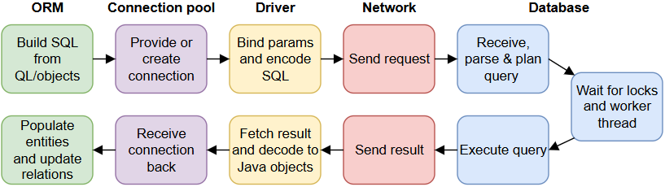
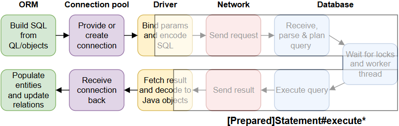
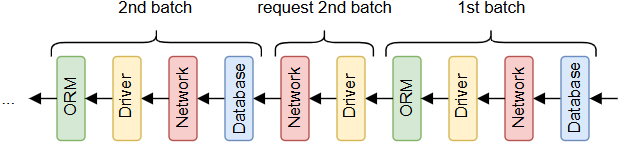
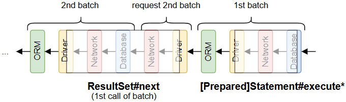

# FAQ

<a id="intro"></a>
## Intro

This FAQ explains how to get started with NPlusOne and resolve common issues.

Did you encounter an issue not covered here, or do you have a tip to share? Feel free to open an issue or submit a pull request to expand this FAQ.

<a id="run-time-faq"></a>
**Runtime monitor**

- [How do I get started with the runtime monitor?](#quick-start-run-time-tool)
- [How do I configure the runtime monitor?](#configure-run-time-tool)
- [How do the dashboard controls and date filters work?](#dashboard-controls)
- [How do I stop or update the Docker monitor without losing findings?](#docker-monitor-lifecycle)
- [How do I share my N+1 findings with my team?](#share-findings)
- [Why aren't any findings appearing in the runtime monitor?](#no-runtime-findings)
- [How do I debug the runtime monitor?](#debug-runtime-monitor)
- [Can I use the detector when my application already uses OpenTelemetry?](#existing-opentelemetry)

<a id="test-assertions-faq"></a>
**Test assertions**

- [How do I get started with the test assertions?](#quick-start-test-asserts)
- [How do I configure the test assertions?](#configure-test-asserts)
- [How do I disable the test assertions?](#disable-test-asserts)
- [How do I exclude SQL noise, such as queries from the test setup?](#avoid-sql-noise)
- [How can I see every SQL query sent by a test?](#see-all-test-sql)
- [How do I reuse an @AssertNoNPlusOneQueryPatterns configuration?](#reuse-annotation-config)
- [What changes does NPlusOne require when migrating from JUnit 4 to JUnit 5?](#junit-4-to-5)
- [What happens if a test fails for a different reason than N+1 issues?](#test-failure)
- [Why does my test pass even though I expect an N+1 issue?](#no-test-assertions)
- [How do I debug the test assertions?](#debug-test-assertions)

<a id="other-faq"></a>
**Other questions**

- [What is a N+1 query pattern, and how does NPlusOne identify it?](#n-plus-one-def)
- [How is the query duration defined?](#query-duration)

<a id="quick-start-run-time-tool"></a>
## How do I get started with the runtime monitor?

1. Download the OpenTelemetry Java agent and the NPlusOne extension.
2. Start the NPlusOne backend and frontend with Docker Compose, or as separate Java processes.
3. Start the application you want to monitor.

Note: _no_ changes to your application's source code are required.

### 1. Download the OpenTelemetry Java agent and the NPlusOne extension

Download the OpenTelemetry Java agent from [its GitHub releases page](https://github.com/open-telemetry/opentelemetry-java-instrumentation/releases).

Download the `opentelemetry-javaagent.jar` from the latest release.

The NPlusOne extension for this Java agent can be downloaded from [this project's releases page](https://github.com/bl-g/NPlusOne/releases).

Download the `nplusone-javaagent-extension-0.1.0-beta.2.jar`.

### 2. Start the NPlusOne backend and frontend

Download [compose.yaml](../compose.yaml). With Docker and Docker Compose installed, run this command in the directory containing the file:

```shell
docker compose up -d
```

Open [http://localhost:8082](http://localhost:8082). The backend API uses port `8081`, and the OTLP/gRPC receiver uses port `4317`.
All ports are bound to localhost. Findings persist in a Docker named volume. No local Java installation is needed for these containers;
the application you monitor still needs Java and the agents from step 1.

#### Alternative: separate Java processes

If you have cloned this project, run the below commands from the repository root in separate PowerShell terminals.

Backend (or `./gradlew` on Linux/macOS):
```shell
.\gradlew.bat :nplusone-runtime-backend:bootRun
```

Frontend:
```shell
.\gradlew.bat :nplusone-runtime-frontend:bootRun
```

Alternatively, download the backend and frontend JARs from [this project's releases page](https://github.com/bl-g/NPlusOne/releases)
and run each in a separate terminal:
```shell
java -jar nplusone-runtime-backend-0.1.0-beta.2.jar
```
Then start the frontend:
```shell
java -jar nplusone-runtime-frontend-0.1.0-beta.2.jar
```

### 3. Start the application you want to monitor

Start your application with the OpenTelemetry Java agent and the NPlusOne extension. This example uses Bash line continuations;
in PowerShell, put the command on one line or replace each trailing `\` with a backtick.

```shell
java \
  -javaagent:/path/to/opentelemetry-javaagent.jar \
  -Dotel.javaagent.extensions=/path/to/nplusone-javaagent-extension-0.1.0-beta.2.jar \
  -Dotel.service.name=my-app \
  -Dotel.exporter.otlp.endpoint=http://localhost:4317 \
  -Dotel.exporter.otlp.protocol=grpc \
  -Dotel.metrics.exporter=none \
  -Dotel.logs.exporter=none \
  -jar my-app.jar
```

This endpoint assumes your application runs on the host. Inside another container, `localhost` refers to that container;
use an address that can reach the detector's OTLP receiver instead. The supplied Compose file publishes its ports only on the host's loopback interface.

Send requests that execute JDBC queries, then open [http://localhost:8082](http://localhost:8082) to view the results.

<a id="configure-run-time-tool"></a>
## How do I configure the runtime monitor?

For Docker Compose, create a `.env` file beside `compose.yaml` to select an image version or change host ports:

```properties
NPLUSONE_VERSION=latest
NPLUSONE_FRONTEND_PORT=9082
NPLUSONE_BACKEND_PORT=9081
NPLUSONE_OTLP_PORT=5317
```

Run `docker compose up -d` again, open `http://localhost:9082`, and change the monitored application's OTLP endpoint to
`http://localhost:5317`. Compose updates the browser's backend URL and the backend's allowed frontend origin to match.
Container ports stay unchanged. Without overrides, the ports are `8082`, `8081`, and `4317`, respectively.

Configure the backend and frontend with Spring properties, and configure the OpenTelemetry Java agent and the NPlusOne extension with
JVM system properties. For containers, set backend/frontend properties through their `environment` entries in `compose.yaml`;
the database path defaults to `/data/nplusone.db` in the backend image, on the persistent volume.
For separate Java processes, the defaults below apply:

- Backend `server.port` (default: `8081`): HTTP API port. It must match the port used by the frontend's
`nplusone.backend-url`.
- Backend `nplusone.otlp-port` (default: `4317`): OTLP/gRPC receiver port. It must match the port in the application's
`otel.exporter.otlp.endpoint`.
- Backend `nplusone.database-path` (default: `nplusone.db`): path to the SQLite database file.
- Backend `nplusone.frontend-origin` (default: `http://localhost:8082`): allowed origin for frontend requests to the rows API.
- Backend `nplusone.live-updates.queue-capacity` (default: `10`, minimum: `1`): maximum queued delivery tasks per live
subscriber, including heartbeats, in addition to one active send. A full queue closes the publisher and requests disconnection.
This limits task count, not payload size.
- Backend `nplusone.live-updates.max-subscribers` (default: `10`, minimum: `1`): maximum registered live subscribers.
Additional subscriptions receive HTTP `503`. Workers still exiting after a subscriber is removed are not included in this count.
- Frontend `server.port` (default: `8082`): frontend HTTP port. It must match the backend's `nplusone.frontend-origin`.
- Frontend `nplusone.backend-url` (default: `http://localhost:8081/api/rows`): URL of the backend rows API.
- Frontend `nplusone.ui.hide-proxy-frames` (default: `true`): hide recognized Spring CGLIB (`$$SpringCGLIB$$` followed by digits)
  and JDK (`$Proxy` followed by digits) proxy frames in the call tree. The backend classifies frames by their generated class names;
  no application classes are loaded by the backend. Visible children attach to the nearest visible ancestor, so `A > proxy > B/C`
  becomes `A > B/C`. Lambda frames remain visible. Raw stored traces, stack-trace filters, SQL grouping, counts and timings are unchanged;
  the Table view still exposes the captured trace. Set `-Dnplusone.ui.hide-proxy-frames=false` on the frontend to show proxy frames again.
  This also applies to existing recordings when served by the updated backend; no recapture or database migration is needed.
- Frontend `nplusone.call.requests.tasks` (default: `false`): use Task wording instead of Request and show the briefcase (Tasks) filter.
  All includes unassociated SQL queries; Tasks excludes them. When false, the Tasks button is hidden. This replaces the old
  `nplusone.hide-server-operations` setting. For a standalone frontend, pass `-Dnplusone.call.requests.tasks=true` before
  `-jar`; in Compose, add `NPLUSONE_CALL_REQUESTS_TASKS: "true"` to the frontend service's environment.
- Agent `nplusone.stacktrace.application-package-prefixes` (default: empty): comma-separated application package prefixes whose stack frames
are captured. Classes in those packages and their subpackages match, but `com.example.foo` does _not_ match `com.example.foobar`.
Set it to `*` to include all packages, subject to `nplusone.stacktrace.max-stack-frames`. When empty, known library packages are excluded instead.
- Agent `nplusone.stacktrace.max-stack-frames` (default: `100`, minimum: `1`): maximum number of application stack frames captured for each
JDBC query.

<a id="dashboard-controls"></a>
## How do the dashboard controls and date filters work?

Hover over an icon to see its name. The view buttons select Table (grid), Tree (green branches), or Bar chart (colored bars).
The Expand group controls all request groups; a request's own menu changes only that request. The Level button and number picker
expand the tree to a chosen branching level.

Use **Source code** in the header to link captured filenames to your local IntelliJ project. Enter the project name shown in IntelliJ and source folders relative to that project (for example, `selene-core/src/main/java`). Package or class prefixes select the folder, with the most specific matching prefix taking precedence; a blank prefix provides a default. Exact class prefixes can distinguish test classes that share their application's package.

You can also paste a link from IntelliJ's **Copy Path/Reference → Toolbox URL**. NPlusOne fills in the project and, for conventional `src/main/java` or `src/test/java` layouts, suggests a source-folder mapping. Class-reference URLs (`fqn=`) fill in the project and package, but need a source folder entered manually because they contain no file path. An existing matching source-folder mapping is preserved. Check the inferred prefix before saving. Settings are stored in your browser and apply to both live and search views. **JetBrains Toolbox must be installed and running.** Links open your local checkout at the captured line, so use the source version matching the monitored application. Frames without a filename and line number, or without a matching mapping, remain plain text. This feature does not upload source code or display it inside the dashboard.

In Table view, Request start combines the timestamp and formatted request duration in parentheses; the next column shows the request name. Task wording applies when enabled.

The Bar chart's x-bar (x?) toggle, after the Sort by buttons, averages SQL and N+1 counts across loaded, filtered requests with the same name. Toggle it to return to individual requests. Searching or loading more rows updates those averages.

In Table view, Sort SQLs sorts queries within each request by execution count (database with a blue `#`), cumulative duration
(stopwatch), or first execution date (calendar). The up/down arrows select ascending/descending order. Request groups retain
their order. The chart sorts requests by date, SQL count, or N+1 issue count; its axis groups let you set bounds or restore Auto.

The funnel and chevron open or close Filters. Filter expressions hide matching rows; use `NOT` to search for matching data.
The green check beside the funnel pauses the whole filter set without deleting its definitions. It becomes an amber pause icon;
click that icon to resume. The per-filter plus/minus buttons apply or remove individual filters from the expression.
Slowest X SQLs per request keeps the X query groups with the highest cumulative JDBC duration in each request. When Task wording
is enabled, these labels refer to tasks instead. Timing percentages are based on the request/task duration or total query time,
as indicated in each label; cumulative JDBC time can exceed the request/task duration when queries run in parallel.

The pause icon in Live mode pauses incoming display updates and becomes a play icon to resume them. The eraser clears the
currently displayed rows; stored findings remain available in Search mode. The magnifying glass with a separate arrow opens Search.
From, To, and Search share a border; Load all is separate. Both dates are optional. From must not be later than To; equal values
are allowed. Invalid ranges use the To field's standard browser validation popup, and the backend also validates them.
These are browser-native date/time pickers: their format follows browser/OS settings, including whether they use AM/PM.
Displayed result timestamps use day/month/year and 24-hour time; Search tree rows include the date as well as the time.

Help > Show tour walks through the controls using demo data. Next or Enter advances; when Next is disabled, Enter activates Skip
to perform the required demo action. The tour restores the real dashboard state when it closes.

<a id="docker-monitor-lifecycle"></a>
## How do I stop or update the Docker monitor without losing findings?

Run these commands in the directory containing `compose.yaml`. To stop the monitor and keep its findings:

```shell
docker compose down
```

Start it again with `docker compose up -d`. The SQLite database is kept in the `nplusone-data` named volume.
Do not add `--volumes` (or `-v`) to `down` if you want to keep that data.

To download updated images and recreate the containers:

```shell
docker compose pull
docker compose up -d
```

The default image tag is `latest`. To pin a release, set `NPLUSONE_VERSION` in `.env` beside `compose.yaml` before running these commands.

<a id="share-findings"></a>
## How do I share my N+1 findings with my team?
NPlusOne stores findings in SQLite. Stop the backend before copying the database file so that pending writes are flushed; do not
copy only the main database file while it is running, because recent data may still be in SQLite's write-ahead log.

Share the copied database file with your team. Team members can start their own backend with `nplusone.database-path` pointing to
their local copy, then open the frontend and switch from the live view to the search view to find the saved results.

<a id="no-runtime-findings"></a>
## Why aren't any findings appearing in the runtime monitor?

Check that:
- The backend and frontend are running, and the frontend's `nplusone.backend-url` points to the backend.
- The monitored application starts with both `-javaagent:/path/to/opentelemetry-javaagent.jar` and `-Dotel.javaagent.extensions=/path/to/nplusone-javaagent-extension-0.1.0-beta.2.jar`.
- `otel.javaagent.enabled` is not `false`, and trace exporting is enabled.
- `otel.exporter.otlp.endpoint` points to the backend's OTLP port (default: `4317`), and `otel.exporter.otlp.protocol` is `grpc`.
- You have sent requests that execute JDBC queries. Queries from before the agent started are not captured.
- `nplusone.stacktrace.application-package-prefixes` includes the relevant application packages.

<a id="debug-runtime-monitor"></a>
## How to debug the runtime monitor?

With Docker Compose, first check container status and logs:

```shell
docker compose ps
docker compose logs --tail=100 backend frontend
```

To debug, enable `DEBUG` logging for `com.goosb.nplusone` in the backend's logging configuration. Look for:

- `Received trace export`: confirms that traces reached the backend. If missing, check the application's OTLP endpoint, protocol, and trace exporter.
- `Resolved ... JDBC spans and received ... server spans`: shows the JDBC and server spans available for processing. If no JDBC spans appear, check JDBC instrumentation and any errors about missing span attributes.
- `Gathered upserts for ... rows`: shows how many rows were created or updated.
- `SSE subscriber #... added`: confirms that a live-update connection reached the backend.
- `Publishing runtime rows`: shows how many rows are being published and the number of active subscribers. If there are no subscribers, check the frontend's backend URL and whether live mode is open.
- `Failed SSE delivery`: indicates that sending an update to a subscriber failed; the exception provides details.

For agent diagnostics, also set `otel.javaagent.debug=true` in the monitored application's JVM. Agent logging is separate from backend logging. Look for:

- `Installing N+1 runtime agent extension`: confirms that the extension loaded. If missing, check the application's `-javaagent` and `otel.javaagent.extensions` settings, and ensure `otel.javaagent.enabled` is not `false`.
- `Configured JDBC stack capture`: shows the application package prefixes and maximum number of captured frames.
- `Enriched JDBC span`: confirms that a JDBC span received a stack trace ID.
- `Skipping JDBC stack capture`: indicates that no application stack frames matched. Check `nplusone.stacktrace.application-package-prefixes`.

<a id="existing-opentelemetry"></a>
## Can I use the detector when my application already uses OpenTelemetry?

Yes. If your application already uses the OpenTelemetry Java agent, add the NPlusOne extension to that agent rather than attaching a second agent:
```shell
-Dotel.javaagent.extensions=/path/to/nplusone-javaagent-extension-0.1.0-beta.2.jar
```

<a id="quick-start-test-asserts"></a>
## How do I get started with the test assertions?

The test integration requires Java 17 or newer and supports JUnit 4 and JUnit 5. The extension created for JUnit 5 also works on JUnit 6.

1. Apply the NPlusOne Gradle or Maven plugin and add the JUnit 4 or Jupiter integration dependency.
2. Add `@AssertNoNPlusOneQueryPatterns` to the relevant tests.

Add the annotation and register the JUnit 4 rule or Jupiter extension. A small refactor can help [exclude SQL noise](#avoid-sql-noise). Work on other threads must
propagate the OpenTelemetry context (and finish before the test completes). This works out-of-the-box for most well-known
[Java/Kotlin libraries and frameworks](https://opentelemetry.io/docs/zero-code/java/agent/supported-libraries/).

### 1. Configure the build plugin

Gradle Kotlin DSL: apply the Java and NPlusOne plugins in `build.gradle.kts`. The N+1 plugin attaches the test Java agent to test tasks. Add `testImplementation("com.goosb.nplusone:nplusone-test-junit-jupiter:0.1.0-beta.2")` for Jupiter or use `nplusone-test-junit4` for JUnit 4. Configure package prefixes to include your application and test code when needed.

```kotlin
plugins {
    java
    id("com.goosb.nplusone") version "0.1.0-beta.2"
}

nplusone {
    applicationPackagePrefixes.set("test.com.foo,com.foo")
}
```

For JUnit 5 or 6, configure `useJUnitPlatform()` on your test task if it is not already configured.

Maven: add the plugin inside `<build><plugins>`. Its `prepare-agent` goal runs during initialize, resolves and attaches the test agent,
and disables telemetry exports. Keep test JVM forking enabled (`forkCount=0` is unsupported). Surefire's `test` and Failsafe's
`integration-test` goals are configured automatically, preserving existing JVM arguments and execution-specific overrides.
No Maven extension declaration or `nplusone.agentArgLine` placeholder is required. Existing explicit placeholders remain supported.

```xml
<plugin>
    <groupId>com.goosb.nplusone</groupId>
    <artifactId>nplusone-plugin-maven</artifactId>
    <version>0.1.0-beta.2</version>
    <configuration>
        <applicationPackagePrefixes>test.com.foo,com.foo</applicationPackagePrefixes>
    </configuration>
    <executions>
        <execution>
            <goals><goal>prepare-agent</goal></goals>
        </execution>
    </executions>
</plugin>
```

Also add `nplusone-test-junit-jupiter` (or `nplusone-test-junit4`) inside `<dependencies>`; the Maven plugin checks that its version matches the detector version:
```xml
<dependency>
    <groupId>com.goosb.nplusone</groupId>
    <artifactId>nplusone-test-junit-jupiter</artifactId>
    <version>0.1.0-beta.2</version>
    <scope>test</scope>
</dependency>
```

Run the tests through Gradle or Maven after annotating them.

### 2. Add `@AssertNoNPlusOneQueryPatterns` to the relevant tests

Add `@AssertNoNPlusOneQueryPatterns` to a test method or class. A class annotation applies to all of its test methods; a method annotation
overrides the class configuration. By default, the test fails when it detects any N+1 query pattern.

For Jupiter, register the extension on the test class or method with `@ExtendWith(NPlusOneTestJupiterExtension.class)`. Import both NPlusOne types from `com.goosb.nplusone.test` and `ExtendWith` from `org.junit.jupiter.api.extension`. Unannotated methods are ignored unless a class-level assertion configuration applies.

JUnit 4 requires this rule:

```java
@Rule
public final NPlusOneQueriesJUnit4Rule nplusone = new NPlusOneQueriesJUnit4Rule();
```

<a id="annotation-attributes"></a>
The annotation has some optional attributes:

- `maxNPlusOneIssues` (default: `0`, minimum: `0`): maximum number of N+1 query patterns allowed.
- `nPlusOneQueryCount` (default: `2`, minimum: `1`): minimum number of queries with the same SQL (after any configured normalization)
and captured call site that is considered an N+1 query pattern.
- `includeSql` (default: includes all SQL): a `SqlFilter` implementation that selects the SQL queries to check. It must have a public
no-argument constructor.
- `includeStackTrace` (default: includes all stack traces): a `StackFrameFilter` implementation that selects stack traces to check. The filter
receives one formatted application stack frame at a time; a stack trace is included if any frame matches. The filter implementation must have a
public no-argument constructor.
- `normalizeSql` (default: `DefaultSqlNormalizer`): a `SqlNormalizer` implementation that normalizes SQL before grouping queries into
patterns. The default returns SQL unchanged, so whitespace, case, comments, and literals must match exactly. Supply a custom normalizer to
opt into normalization. Custom normalizers must have a public no-argument constructor.

<a id="configure-test-asserts"></a>
## How do I configure the test assertions?

Set this property in the test JVM (see [how to disable assertions](#disable-test-asserts)):

- `nplusone.test.agent.disabled` (default: `false`): disables N+1 assertions when set to `true`.

The Gradle plugin's `nplusone` extension also supports `enabled` (default: `true`), `nplusoneVersion` (default: `0.1.0-beta.2`), and `applicationPackagePrefixes`.
The Maven plugin supports the same settings in its `<configuration>`.
Maven's `nplusoneVersion` must match the chosen `nplusone-test-junit4` or `nplusone-test-junit-jupiter` dependency version.
Setting `enabled` to `false` disables both instrumentation and assertions.

The test agent also uses the runtime agent properties:

- `nplusone.stacktrace.application-package-prefixes` (default: empty): comma-separated application package prefixes whose stack frames are
captured. Classes in those packages and their subpackages match; for example, `com.example.foo` does not match `com.example.foobar`.
Set it to `*` to include all packages, subject to `nplusone.stacktrace.max-stack-frames`. When empty, known library packages are excluded instead.
- `nplusone.stacktrace.max-stack-frames` (default: `100`, minimum: `1`): maximum number of application stack frames captured for each JDBC
query.

See also:

- [Runtime configuration](#configure-run-time-tool).
- [Attributes of `@AssertNoNPlusOneQueryPatterns`](#annotation-attributes).
- [Reusing an annotation configuration](#reuse-annotation-config).

<a id="disable-test-asserts"></a>
## How do I disable the test assertions?

Set `nplusone.test.agent.disabled=true` to skip N+1 assertions, for example while diagnosing an unrelated failure.
The Gradle plugin also omits the test agent when this property is set on the Gradle invocation.

[Maven Surefire forwards command-line user properties to the test JVM by default](https://maven.apache.org/surefire/maven-surefire-plugin/test-mojo.html#promoteUserPropertiesToSystemProperties),
so `mvn test -Dnplusone.test.agent.disabled=true` disables assertions. The Gradle plugin forwards this property to its test JVM.

To disable both instrumentation and assertions in the build configuration,
set `nplusone { enabled.set(false) }` in Gradle or `<enabled>false</enabled>` in the Maven plugin configuration.
For a single Gradle invocation, use `./gradlew test -Dnplusone.test.agent.disabled=true`.
For Maven, use `mvn test -Dnplusone.enabled=false`; the plugin skips agent attachment and disables assertions.
Maven still validates the detector version and the matching JUnit integration dependency when instrumentation is disabled.

<a id="avoid-sql-noise"></a>
## How do I exclude SQL noise, such as queries from the test setup?

A typical test has setup ('given'), an action ('when'), and assertions ('then'). Use `includeStackTrace` to select queries whose captured
stack contains a frame from the tested action. Queries from setup or assertions are excluded if their stacks do not contain that frame.

JUnit 5 captures the test method, excluding `@BeforeEach` and `@AfterEach`. The JUnit 4 rule also captures `@Before` and `@After`.
Setup and assertions inside the test method are captured in both integrations.

Similarly, health check queries and other SQL noise can be excluded from the N+1 query pattern count by using the `includeSql` attribute.

```java
import com.goosb.nplusone.test.attributes.StackFrameFilter;

public class TestFoo {

    public static class OnlyStackTracesFromTestFooBar implements StackFrameFilter {

        @Override
        public boolean include(String stackFrame) {
            return stackFrame.contains("TestFoo.doBar(");
        }
    }

    @Test
    @AssertNoNPlusOneQueryPatterns(includeStackTrace = OnlyStackTracesFromTestFooBar.class)
    public void testBar() {
        // given: prepare test data

        // when
        doBar();

        // then: verify the result
    }

    public void doBar() {
        // Call the application code that executes the queries to check.
    }
}
```

Include the package containing `TestFoo` in `nplusone.stacktrace.application-package-prefixes` and capture enough stack frames to retain `doBar`.

<a id="see-all-test-sql"></a>
## How can I see every SQL query sent by a test?
The N+1 runtime monitor is specifically designed to show all SQL queries triggered by a running application,
but you may also be interested to see which SQL queries are triggered by a certain test.
For this purpose, the minimum value of `nPlusOneQueryCount` is `1` instead of the more obvious `2`.
Set `nPlusOneQueryCount = 1` and leave `maxNPlusOneIssues` at its default of `0` (see below).
If the test then triggers any captured SQL queries,
the assertion fails and its message shows each query with its matching call site/stack trace.

```java
@AssertNoNPlusOneQueryPatterns(nPlusOneQueryCount = 1)
```

<a id="reuse-annotation-config"></a>
## How do I reuse an @AssertNoNPlusOneQueryPatterns configuration?

Create a composed annotation with the configuration you want to reuse, then apply it to test methods or classes. JUnit 4 still requires the rule. For Jupiter, register the extension on the test class or add `@ExtendWith(NPlusOneTestJupiterExtension.class)` to the composed annotation.

For example:

```java
@Retention(RetentionPolicy.RUNTIME)
@Target({ElementType.METHOD, ElementType.TYPE})
@AssertNoNPlusOneQueryPatterns(maxNPlusOneIssues = 1)
public @interface AssertMaxOneNPlusOneQueryPatterns {}
```

Apply it to a test:

```java
@Test
@AssertMaxOneNPlusOneQueryPatterns
public void testFoo() {}
```

<a id="junit-4-to-5"></a>
## What changes does NPlusOne require when migrating from JUnit 4 to JUnit 5?

Replace the `nplusone-test-junit4` dependency with `nplusone-test-junit-jupiter`. Remove the `@Rule NPlusOneQueriesJUnit4Rule` field and add `@ExtendWith(NPlusOneTestJupiterExtension.class)` to the test class. Keep the shared assertion annotations and their configuration.

The Jupiter extension is registered explicitly; the shared `AssertNoNPlusOneQueryPatterns` annotation has no JUnit dependency.
The build plugin configuration also stays the same.

Note though: the capture window changes, since a JUnit 4 rule includes `@Before` and `@After`, while the JUnit 5 extension excludes the equivalent `@BeforeEach` and `@AfterEach`.

<a id="test-failure"></a>
## What happens if a test fails for a different reason than N+1 issues?

If the test already failed when the N+1 check runs, the detector skips its assertion and preserves the original error.
It does not add a suppressed N+1 assertion error.

<a id="no-test-assertions"></a>
## Why does my test pass even though I expect an N+1 issue?

A test passes when the number of detected patterns does not exceed `maxNPlusOneIssues`. If you expected it to fail, check that:
- `@AssertNoNPlusOneQueryPatterns` is applied to the test method or class. JUnit 4 also requires the `NPlusOneQueriesJUnit4Rule`; Jupiter requires `@ExtendWith(NPlusOneTestJupiterExtension.class)`.
- Neither `nplusone.test.agent.disabled=true` nor `otel.javaagent.enabled=false` is set.
- The repeated queries have the same SQL (after any configured normalization) and captured call site, and their count reaches `nPlusOneQueryCount`.
- `includeSql` and `includeStackTrace` do not exclude the queries.
- `nplusone.stacktrace.application-package-prefixes` includes the relevant packages, and `nplusone.stacktrace.max-stack-frames` retains the relevant frames.
- The queries run during the capture window. JUnit 5 captures the test method; the JUnit 4 rule also captures `@Before` and `@After`.
- Work on other threads propagates the OpenTelemetry context (and finishes before the test completes). This works out-of-the-box for [supported libraries and frameworks](https://opentelemetry.io/docs/zero-code/java/agent/supported-libraries/).

If the test Java agent is missing, an annotated test throws an exception (unless `nplusone.test.agent.disabled=true`).

If needed, you could also [debug NPlusOne](#debug-test-assertions).

<a id="debug-test-assertions"></a>
## How to debug the test assertions?

To debug, enable `DEBUG` logging for `com.goosb.nplusone.test` in your test application's logging configuration. Look for:
- `Skipping N+1 capture`: explains why capture was skipped, such as disabled assertions or a missing annotation in JUnit 4.
- `Started N+1 capture`: shows the trace ID, thresholds, and filter classes.
- `Completed N+1 capture`: shows how many JDBC spans were captured and how many remain after each filter.
- `Skipping N+1 assertion`: explains why the check was skipped, such as an existing test failure.
- `N+1 evaluation`: shows query group and pattern counts, missing attributes, and the `PASS` or `FAIL` result.

For agent diagnostics, also set `otel.javaagent.debug=true` in the test JVM. Agent logging is separate from application logging. Look for:
- `Installing N+1 test agent extension`: confirms that the extension loaded. If missing, check the test JVM's `-javaagent` argument and ensure `otel.javaagent.enabled` is not `false`.
- `Captured JDBC span for N+1 test`: confirms that a query was captured and shows whether its SQL and stack trace attributes are present.
- `Ignoring JDBC span outside an active N+1 test capture`: indicates that the query's trace has no active test capture. Check the capture window and OpenTelemetry context propagation.

<a id="n-plus-one-def"></a>
## What is a N+1 query pattern, and how does NPlusOne identify it?
A N+1 query pattern occurs if an application uses a SQL query to load a collection of items, followed by one or more additional queries _per item_ to (lazy) load additional values. With a large number of items this implies a large number of queries, which can cause significant time-performance problems due to the overhead associated with each query, in particular the latency between the application server and the database server.

N+1 query problems are commonly caused by seemingly harmless code that relies on an ORM and involves some form of a loop. For example, see the code below: if the `owner` field is not part of the field values that are fetched by default when loading a `Pet`, then each Pet's owner is loaded lazily. In other words, the application sends a single `SELECT * FROM Pet` query, followed by a `SELECT * FROM Owner WHERE id = ?` query _for each Pet_. The strength of an ORM, abstracting away the SQL layer, is in cases like this also its weakness.
```
public Set<String> getOwnerNames() {
    return petRepository.findAll()
            .stream()
            .map(pet -> pet.getOwner().getName())
            .collect(Collectors.toSet());
}
```
NPlusOne identifies a N+1 query pattern by looking for repeated queries. Specifically, if a certain method triggers the same SQL query multiple times, then NPlusOne considers it a (potential) N+1 query pattern.

A repeated query is not necessarily a N+1 query problem, or possibly not even a problem at all. NPlusOne cannot reliably use heuristics to distinguish harmless/intentional repeated queries from problematic ones though. Hence, it instead reports all repeated queries, and leaves it to the user to define filters based on the SQL query or strack trace.

<a id="query-duration"></a>
## How is the query duration defined?
NPlusOne shows the time each SQL query takes, and expresses the sum of all query durations as a percentage of the HTTP request duration. Measuring a query's duration is not straightforward though, since there is no universal definition of what should be in- or excluded in a query's execution time. There are many actors and steps involved and definitions differ in which they include: the ORM, the connection pool, the driver, the network, the database. A definition will depend on the layer to focus on and the question that it should answer. For example, if the database should be investigated as a potential bottleneck, then the 'query duration' should only include the steps the database performs. For NPlusOne, the goal is to give the user an idea of the costs of N+1 query issues, and the potential time performance gain of fixing them. Thus it needs a matching definition of 'query duration'.

N+1 queries hurt time performance because they make an application repeatedly pay some of the overhead costs of a query. For example, sending N requests may involve waiting for database locks or worker threads each time. Focusing exclusively on the database execution time would under-count the real costs of N+1 query issues though: sending N requests also implies N round trips to the database, which means paying network/latency costs N times. Similarly, the driver has to encode and decode N queries. N+1 queries also mean that the ORM has to populate entities and update its persistence context N times. The impact on time-performance is typically smaller here though, and the additional ORM overhead is harder to distinguish from steps which the ORM also had to perform in the absence of N+1 query problems.

Roughly speaking, NPlusOne defines a query's duration as: database time + network time + (most of the) driver time. This makes the costs of N+1 queries clearly visible, since especially N times the network time will add up quickly and cause time performance issues. NPlusOne relies applying this definition on OpenTelemetry's Java agent, which under the hood instruments JDBC's `(Prepared)Statement#execute*` methods, such as `PreparedStatement#executeQuery`. In other words, NPlusOne receives JDBC spans whose start and end time match the execution start and end timestamps of these `execute*` methods. An `execute*` method typically starts before the driver starts encoding, thus includes a good part of the driver's work, in addition to the network time and the database time, as well as the time the driver needs to parse the result received off the wire. A driver's configuration impacts the exact steps in- or excluded in the `execute*` method. This impact is most noticeable in queries with a large result set. Thus, in the case of N+1 queries, it typically won't impact the measured duration of the 'N' queries much (though they may still return an entity or collection), but it is relevant for the '1' query. This is something to keep in mind, and is therefore explained in more detail below.

### Driver mode impact on measured query time
A driver's mode determines how it fetches a query's results from the database: all rows at once (buffered mode), in repeated requests for batches (cursor/fetch-batch) or streamed (continuous streaming). A driver's mode can have a big impact on an application's time (and memory) performance, but also impacts which steps are captured by the `(Prepared)Statement#execute*` methods. To illustrate, the images below show a simplified representation of all the steps and actors involved in a query.

**Image a**: _the steps of a query with buffered driver mode, simplified_


**Image b**: _(Prepared)Statement#execute* execution time with buffered driver mode, simplified_


**Image c**: _the (bottom half of) steps of a query with cursor/fetch-batch driver mode), simplified_


**Image d**: _(Prepared)Statement#execute* execution time (bottom half) with cursor/fetch-batch driver mode, simplified_


Image a relates to the buffered mode, which is relatively straightforward: the ORM builds a SQL query, it fetches a TCP connection from a connection pool and the driver binds the parameters and encodes the SQL query into bytes. Next, it sends the encoded query over the network to the database, which then parses it, creates an execution plan, acquires a worker thread, waits for any locks and executes the query. The full results, so all of the rows, are then sent back over the network, so that the driver can decode them again into simple Java objects and let the ORM read them to populate the impacted entities. As shown in image b, with buffered mode the `(Prepared)Statement#execute*` method captures all of the network and database time and most of the driver's time. Binding the query's parameters and decoding the rows' values typically happen before the `execute*` method starts, respectively after it ends, so some of the driver's time is not captured.

Image c shows how the steps differ if the cursor mode is used instead of the buffered mode. The first set of steps (the top half in images a-b) is the same. The difference lies in how the driver and the database interact in fetching the query's results, so image c only shows this part of the query (the bottom half in images a-b). Unlike in the buffered mode, the database does _not_ produce all rows at once. Instead, it returns only a batch over the network. It keeps a cursor in memory to know where its batch ended. The driver and ORM then process this first batch, after which the driver requests the second batch. The database continues at its stored cursor and the process repeats itself from here. Especially if the `fetchSize` (the size of one batch) is small and the number of rows is large, this can imply that the database server and application are much more 'chatty' than with the buffered mode.

As shown in image d, with the cursor mode `(Prepared)Statement#execute*` no longer captures all of the time needed to transfer all of the results/rows. Only the first batch is captured, while every next batch is instead part of the `ResultSet#next` call (the first call of each batch triggers a new round trip to the database). Finally, a driver could use continuous streaming, in which case the database server pushes the results onto the wire continuously. The `execute*` methods then finish at the arrival of the first rows, and every `ResultSet#next` call reads from the socket as needed, rather than sending a new request to the database server. Though this is a different driver mode than the cursor mode, it is equivalent in the sense that the `execute*` methods no longer capture the transfer of the results (except for the first rows).

The main takeaway here is that with a driver that doesn't use the buffered mode, NPlusOne's 'query duration' might under-count the actual time performance costs of N+1 query issues; for large results, the reported duration is a lower bound. However, this applies to queries with a large set of rows, since if all rows fit in the first batch, there is no effective difference between the modes. Thus, it mostly impacts the '1' query, and to a lesser extent the 'N' queries in an N+1 query problem. The actual impact on the measured duration might be small, but it will differ case-by-case. If the reported query time is unexpectedly small compared to the request time, then this might be explained by a driver's fetch settings combined with NPlusOne's definition of 'query duration'.
